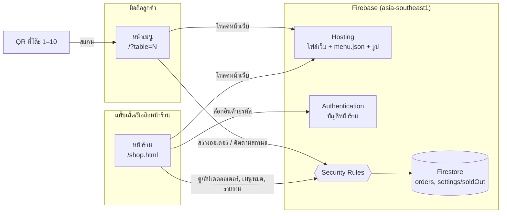
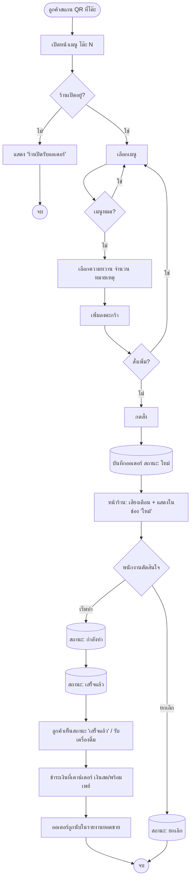
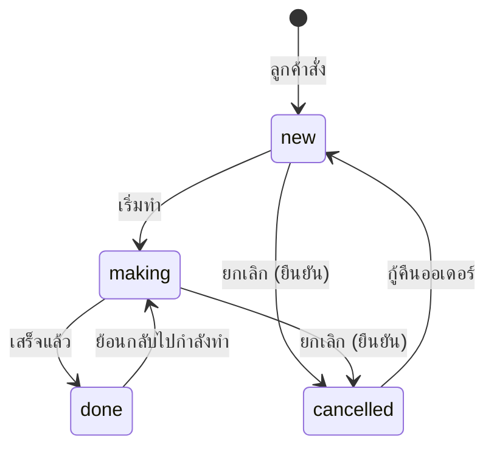

# Software Requirements Specification (SRS)
# ระบบสั่งเครื่องดื่มผ่าน QR Code — LOONG JOKE Coffee Tea Soda

| รายการ | รายละเอียด |
|---|---|
| เวอร์ชันเอกสาร | 1.0 |
| วันที่ | 3 พฤศจิกายน 2569 (2026-11-03) |
| สถานะ | ใช้งานจริง (Production) |
| ระบบที่ใช้งาน | https://loong-joke-coffee-tea-soda.web.app |
| รูปแบบเอกสาร | อ้างอิงโครงสร้าง IEEE 830 / ISO/IEC/IEEE 29148 |

### ประวัติการแก้ไข

| เวอร์ชัน | วันที่ | รายละเอียด |
|---|---|---|
| 1.0 | 2026-11-03 | ฉบับแรก จัดทำจากระบบที่ใช้งานจริง |

---

## สารบัญ

1. [บทนำ](#1-บทนำ)
2. [ภาพรวมของระบบ](#2-ภาพรวมของระบบ)
3. [ความต้องการเชิงฟังก์ชัน](#3-ความต้องการเชิงฟังก์ชัน-functional-requirements)
4. [ความต้องการด้านส่วนต่อประสาน](#4-ความต้องการด้านส่วนต่อประสาน-external-interface-requirements)
5. [ความต้องการด้านข้อมูล](#5-ความต้องการด้านข้อมูล-data-requirements)
6. [ความต้องการที่ไม่ใช่เชิงฟังก์ชัน](#6-ความต้องการที่ไม่ใช่เชิงฟังก์ชัน-non-functional-requirements)
7. [กฎทางธุรกิจ](#7-กฎทางธุรกิจ-business-rules)
8. [ภาคผนวก](#8-ภาคผนวก)

---

## 1. บทนำ

### 1.1 วัตถุประสงค์ของเอกสาร

เอกสารนี้กำหนดความต้องการของระบบสั่งเครื่องดื่มผ่าน QR Code ของร้าน LOONG JOKE Coffee Tea Soda เพื่อใช้เป็นข้อตกลงร่วมกันระหว่างเจ้าของร้าน ผู้พัฒนา และผู้ดูแลระบบในอนาคต ใช้อ้างอิงในการพัฒนา ทดสอบ และแก้ไขระบบ

### 1.2 ขอบเขตของระบบ

ระบบเป็นเว็บแอปที่เปิดผ่านเบราว์เซอร์บนมือถือ ไม่ต้องติดตั้งแอป มี 2 ส่วนหลัก

1. **หน้าเมนูลูกค้า** (`/?table=N`) ลูกค้าสแกน QR ที่โต๊ะ เลือกเครื่องดื่ม ระดับความหวาน จำนวน และหมายเหตุ แล้วส่งออเดอร์ จากนั้นติดตามสถานะออเดอร์ได้
2. **หน้าร้าน** (`/shop.html`) พนักงานเข้าสู่ระบบด้วยรหัส แล้วรับออเดอร์และอัปเดตสถานะ ปิดเมนูที่หมด ดูรายงานยอดขาย และพิมพ์ QR ประจำโต๊ะ

**สิ่งที่อยู่นอกขอบเขต (Out of scope)**

- การชำระเงินออนไลน์ (ลูกค้าจ่ายที่เคาน์เตอร์ด้วยเงินสดหรือพร้อมเพย์)
- การเพิ่ม แก้ไข หรือลบเมนูและราคาผ่านหน้าเว็บ (แก้ที่ไฟล์ `data/menu.json` โดยผู้ดูแลระบบ)
- เครื่องดื่มร้อน เครื่องดื่มปั่น และท็อปปิ้ง
- การแยกสิทธิ์พนักงานกับเจ้าของร้าน (ใช้บทบาทเดียว)
- ระบบสมาชิก แต้มสะสม และการสั่งกลับบ้าน/เดลิเวอรี
- การจัดการสต็อกวัตถุดิบ (มีเพียงการกด "เมนูหมด")

### 1.3 คำนิยามและคำย่อ

| คำ | ความหมาย |
|---|---|
| ลูกค้า (Customer) | ผู้ที่สแกน QR ที่โต๊ะเพื่อสั่งเครื่องดื่ม ไม่ต้องเข้าสู่ระบบ |
| พนักงาน/เจ้าของร้าน (Shop) | ผู้ใช้หน้าร้าน ใช้บทบาทเดียวกันและรหัสเดียวกัน |
| ออเดอร์ (Order) | รายการสั่งซื้อ 1 ครั้งจาก 1 โต๊ะ มีได้หลายรายการเครื่องดื่ม |
| รายการ (Order item) | เครื่องดื่ม 1 ชนิด พร้อมความหวาน จำนวน และหมายเหตุ |
| สถานะออเดอร์ | `new` ใหม่, `making` กำลังทำ, `done` เสร็จแล้ว, `cancelled` ยกเลิก |
| เมนูหมด (Sold out) | เมนูที่ร้านปิดการขายชั่วคราว ลูกค้ากดสั่งไม่ได้ |
| เวลาร้าน | เวลาประเทศไทย (Asia/Bangkok, UTC+7) |
| Firebase | บริการคลาวด์ของ Google ที่ใช้เป็นฐานข้อมูล ระบบล็อกอิน และโฮสต์เว็บ |
| Firestore | ฐานข้อมูลของ Firebase ที่เก็บออเดอร์และการตั้งค่าเมนูหมด |
| Security Rules | กฎฝั่งเซิร์ฟเวอร์ของ Firestore ที่ตรวจสิทธิ์ทุกการอ่าน/เขียน |
| โหมดทดลอง (Demo mode) | ใส่ `?demo=1` ท้ายลิงก์ ข้อมูลเก็บในเบราว์เซอร์เครื่องนั้นเท่านั้น |

### 1.4 เอกสารอ้างอิง

- ไฟล์เมนู: `data/menu.json`
- กฎความปลอดภัยฐานข้อมูล: `firestore.rules`
- ดัชนีฐานข้อมูล: `firestore.indexes.json`
- การตั้งค่าระบบ: `js/config.js`
- Design system "LOONG JOKE" (สี ฟอนต์ และคอมโพเนนต์): `design-system/project/`
- IEEE Std 830-1998 และ ISO/IEC/IEEE 29148:2018

### 1.5 โครงสร้างเอกสาร

หัวข้อที่ 2 อธิบายภาพรวม ผู้ใช้ และข้อจำกัด หัวข้อที่ 3–6 คือความต้องการที่ตรวจสอบได้ แต่ละข้อมีรหัส (เช่น `FR-C-01`) เพื่อใช้อ้างอิงในการทดสอบ หัวข้อที่ 7–8 คือกฎทางธุรกิจและภาคผนวก

---

## 2. ภาพรวมของระบบ

### 2.1 มุมมองของผลิตภัณฑ์

ระบบเป็นเว็บแบบ static (HTML, CSS, JavaScript ไม่มีขั้นตอน build) โฮสต์บน Firebase Hosting และใช้ Firebase เป็น backend โดยไม่มีเซิร์ฟเวอร์ของตัวเอง

### 2.2 ฟังก์ชันหลักของระบบ

| กลุ่ม | ฟังก์ชัน |
|---|---|
| ลูกค้า | ดูเมนูแยกหมวด, เลือกความหวาน/จำนวน/หมายเหตุ, ตะกร้า, ส่งออเดอร์, ติดตามสถานะออเดอร์ของโต๊ะ |
| หน้าร้าน – ออเดอร์ | ล็อกอินด้วยรหัส, บอร์ดออเดอร์ 3 ช่อง, เสียงเตือนออเดอร์ใหม่, เปลี่ยนสถานะ, ยกเลิก/กู้คืน |
| หน้าร้าน – เมนูหมด | สลับเมนู "มีขาย" / "หมด" แบบเรียลไทม์ |
| หน้าร้าน – ยอดขาย | รายงานรายวัน, รายสัปดาห์, ยอดรวมทั้งหมดพร้อมกราฟรายเดือน, ช่วงเวลาที่ขายดี |
| หน้าร้าน – QR โต๊ะ | สร้างและพิมพ์ QR ประจำโต๊ะ |

### 2.3 กลุ่มผู้ใช้

| กลุ่มผู้ใช้ | ลักษณะ | สิทธิ์ |
|---|---|---|
| ลูกค้า | ใช้มือถือของตัวเอง ไม่ต้องสมัครหรือล็อกอิน ความชำนาญด้านเทคโนโลยีหลากหลาย | สร้างออเดอร์ใหม่ (เฉพาะเวลาร้านเปิด), ดูออเดอร์ที่ตนสั่ง, ดูรายการเมนูหมด |
| พนักงาน/เจ้าของร้าน | ใช้แท็บเล็ตหรือมือถือที่หน้าร้าน รู้รหัสหน้าร้าน | ดูออเดอร์ทั้งหมด, เปลี่ยนสถานะ, ตั้งเมนูหมด, ดูรายงาน, พิมพ์ QR |
| ผู้ดูแลระบบ | ผู้ที่แก้ไฟล์โค้ดและสั่ง deploy ผ่าน Firebase CLI | แก้เมนู ราคา จำนวนโต๊ะ เวลาเปิดร้าน และกฎความปลอดภัย |

### 2.4 สภาพแวดล้อมการทำงาน

- **ฝั่งผู้ใช้:** เบราว์เซอร์รุ่นปัจจุบันบน iOS Safari, Android Chrome หรือเบราว์เซอร์เดสก์ท็อป ที่รองรับ ES Modules
- **ฝั่งเซิร์ฟเวอร์:** Firebase project `loong-joke-coffee-tea-soda` แผน Spark (ฟรี) Firestore ภูมิภาค `asia-southeast1`
- **ไลบรารีภายนอก:** Firebase JS SDK 10.14.1 (จาก gstatic), qrcode-generator 1.4.4 (จาก cdnjs), Google Fonts (League Spartan, Prompt, Kanit)
- **เครือข่าย:** ต้องเชื่อมต่ออินเทอร์เน็ตทั้งฝั่งลูกค้าและหน้าร้าน

### 2.5 ข้อจำกัดด้านการออกแบบและการพัฒนา

- ไม่มีเซิร์ฟเวอร์ของตัวเอง สิทธิ์และความถูกต้องของข้อมูลทั้งหมดบังคับด้วย Firestore Security Rules
- ใช้แผน Spark จึงต้องอยู่ในโควตาฟรีของ Firebase (การอ่าน/เขียนต่อวัน) ไม่ใช้ Cloud Functions
- รายการเมนูและราคาอยู่ในไฟล์ `data/menu.json` แก้แล้วต้อง deploy ใหม่
- จำนวนโต๊ะกำหนดไว้ 2 ที่ ต้องแก้ให้ตรงกัน: `TABLE_COUNT` ใน `js/config.js` และเงื่อนไข `d.table <= 10` ใน `firestore.rules`
- เวลาเปิดร้านกำหนดไว้ 2 ที่ ต้องแก้ให้ตรงกัน: `openHours` ใน `data/menu.json` และฟังก์ชัน `isOpen()` ใน `firestore.rules` (เขียนเป็นเวลา UTC)
- หน้าเว็บใช้ธีมสีสว่างเท่านั้น ตาม design system "LOONG JOKE"

### 2.6 สมมติฐานและการพึ่งพา

- ร้านมี 10 โต๊ะ แต่ละโต๊ะมี QR ของตัวเองที่ชี้ไป `https://loong-joke-coffee-tea-soda.web.app/?table=N`
- ร้านเปิด 09:00–16:00 น. ทุกวัน
- ร้านมีอุปกรณ์อย่างน้อย 1 เครื่องเปิดหน้าร้านค้างไว้ระหว่างเวลาทำการ
- ลูกค้าชำระเงินที่เคาน์เตอร์ พนักงานตรวจยอดจากออเดอร์บนหน้าร้าน
- บริการ Firebase ใช้งานได้ตามปกติ

---

## 3. ความต้องการเชิงฟังก์ชัน (Functional Requirements)

ระดับความสำคัญ: **M** = ต้องมี (Must), **S** = ควรมี (Should)

### 3.1 หน้าเมนูลูกค้า

| รหัส | ความต้องการ | ความสำคัญ |
|---|---|---|
| FR-C-01 | ระบบต้องอ่านหมายเลขโต๊ะจากพารามิเตอร์ `?table=N` (N = 1–10) และแสดง "โต๊ะ N" บนหน้าเมนู | M |
| FR-C-02 | หากไม่มีหมายเลขโต๊ะหรือหมายเลขไม่ถูกต้อง ระบบต้องแสดงเมนูได้แต่ไม่ให้สั่ง และแจ้งให้สแกน QR ที่โต๊ะ | M |
| FR-C-03 | ระบบต้องแสดงเมนูแยก 3 หมวด: Ice Coffee, Non Coffee, Soda โดยมีแท็บสลับหมวด | M |
| FR-C-04 | แต่ละเมนูต้องแสดงชื่อภาษาอังกฤษ ชื่อภาษาไทย ราคา และรูป (ถ้ามี) เมนูที่ไม่มีรูปต้องแสดงได้โดยไม่มีภาพเสีย | M |
| FR-C-05 | เมนูที่ร้านตั้งเป็น "หมด" ต้องแสดงป้าย "หมด" และกดสั่งไม่ได้ โดยอัปเดตทันทีโดยไม่ต้องรีเฟรชหน้า | M |
| FR-C-06 | เมื่อกดเมนู ระบบต้องเปิดหน้าต่างเลือก: ระดับความหวาน 4 ระดับ (ไม่หวาน / หวานน้อย / ปกติ / หวานมาก ค่าเริ่มต้น "ปกติ"), จำนวน 1–20 แก้ว และหมายเหตุ (ไม่บังคับ) | M |
| FR-C-07 | ระบบต้องแสดงราคารวมของรายการก่อนกด "เพิ่มลงตะกร้า" | M |
| FR-C-08 | รายการที่เมนู ความหวาน และหมายเหตุตรงกัน ต้องรวมเป็นบรรทัดเดียวในตะกร้า (จำนวนรวมไม่เกิน 20) | S |
| FR-C-09 | ตะกร้าต้องแสดงจำนวนแก้วและยอดรวม และให้ปรับจำนวนหรือลบรายการได้ | M |
| FR-C-10 | ตะกร้าต้องแสดงข้อความว่าชำระเงินที่เคาน์เตอร์ (เงินสด / พร้อมเพย์) | M |
| FR-C-11 | เมื่อกดสั่ง ระบบต้องบันทึกออเดอร์พร้อมหมายเลขโต๊ะ รายการ ยอดรวม สถานะ `new` และเวลาจากเซิร์ฟเวอร์ แล้วล้างตะกร้า | M |
| FR-C-12 | ระบบต้องแสดง "ออเดอร์ของโต๊ะนี้" ที่ลูกค้าสั่งจากเบราว์เซอร์นั้น พร้อมสถานะที่อัปเดตแบบเรียลไทม์ (ใหม่ / กำลังทำ / เสร็จแล้ว / ยกเลิก) | M |
| FR-C-13 | นอกเวลา 09:00–16:00 น. ระบบต้องแสดงประกาศ "ตอนนี้ร้านปิดรับออเดอร์" และไม่ให้ส่งออเดอร์ | M |
| FR-C-14 | หากส่งออเดอร์ไม่สำเร็จ ระบบต้องแจ้งข้อผิดพลาดเป็นภาษาไทย และคงตะกร้าไว้ให้ลองใหม่ | M |

### 3.2 หน้าร้าน – การเข้าสู่ระบบ

| รหัส | ความต้องการ | ความสำคัญ |
|---|---|---|
| FR-S-01 | ระบบต้องให้เข้าสู่หน้าร้านด้วยการกรอก **รหัสอย่างเดียว** (ไม่ต้องกรอกอีเมล) | M |
| FR-S-02 | หากรหัสผิด ระบบต้องแสดงข้อความผิดพลาดและไม่แสดงข้อมูลร้าน | M |
| FR-S-03 | ระบบต้องจำการเข้าสู่ระบบไว้บนอุปกรณ์นั้นจนกว่าจะกด "ออกจากระบบ" | S |
| FR-S-04 | ระบบต้องมีปุ่ม "ออกจากระบบ" | M |

### 3.3 หน้าร้าน – จัดการออเดอร์ (แท็บ "ออเดอร์")

| รหัส | ความต้องการ | ความสำคัญ |
|---|---|---|
| FR-O-01 | ระบบต้องแสดงออเดอร์ของวันนี้แบบเรียลไทม์ แบ่ง 3 ช่อง: **ใหม่**, **กำลังทำ**, **เสร็จแล้ว / ยกเลิก** พร้อมจำนวนในแต่ละช่อง | M |
| FR-O-02 | แต่ละออเดอร์ต้องแสดงหมายเลขโต๊ะ เวลาสั่ง รายการ (ชื่อ ความหวาน จำนวน หมายเหตุ) และยอดรวม | M |
| FR-O-03 | ระบบต้องเล่นเสียงเตือนเมื่อมีออเดอร์ใหม่เข้ามา และแสดงแถบ "แตะเพื่อเปิดเสียง" หากเบราว์เซอร์ยังไม่อนุญาตให้เล่นเสียง | M |
| FR-O-04 | ชื่อแท็บเบราว์เซอร์ต้องแสดงจำนวนออเดอร์ใหม่ที่รออยู่ เช่น "(2) หน้าร้าน" | S |
| FR-O-05 | ปุ่มเปลี่ยนสถานะ: ออเดอร์ใหม่ → "เริ่มทำ" (`making`), กำลังทำ → "เสร็จแล้ว" (`done`) | M |
| FR-O-06 | ออเดอร์ใหม่หรือกำลังทำต้องยกเลิกได้ (`cancelled`) โดยต้องกดยืนยันอีกครั้งก่อนยกเลิก | M |
| FR-O-07 | ออเดอร์ที่เสร็จแล้วต้องย้อนกลับเป็น "กำลังทำ" ได้ และออเดอร์ที่ยกเลิกต้องกู้คืนเป็น "ใหม่" ได้ | S |
| FR-O-08 | ระหว่างบันทึกสถานะ ปุ่มต้องแสดง "กำลังบันทึก…" และกดซ้ำไม่ได้ | S |
| FR-O-09 | ระบบต้องขอให้หน้าจอไม่ดับ (Screen Wake Lock) ขณะเปิดหน้าร้าน ในเบราว์เซอร์ที่รองรับ | S |
| FR-O-10 | ระบบต้องเปลี่ยนไปแสดงออเดอร์ของวันใหม่อัตโนมัติเมื่อข้ามเที่ยงคืน (ตรวจทุก 30 วินาที) | S |
| FR-O-11 | ระบบต้องไม่มีฟังก์ชันลบออเดอร์ ออเดอร์ทุกใบถูกเก็บไว้เพื่อใช้ในรายงาน | M |

### 3.4 หน้าร้าน – เมนูหมด (แท็บ "เมนูหมด")

| รหัส | ความต้องการ | ความสำคัญ |
|---|---|---|
| FR-T-01 | ระบบต้องแสดงรายการเมนูทั้งหมดแยกตามหมวด พร้อมสถานะ "มีขาย" หรือ "หมด" | M |
| FR-T-02 | การกดที่เมนูต้องสลับสถานะ และหน้าลูกค้าทุกเครื่องต้องเห็นผลทันที | M |
| FR-T-03 | สถานะเมนูหมดต้องคงอยู่จนกว่าร้านจะกดเปลี่ยนกลับ (ไม่รีเซ็ตอัตโนมัติ) | M |

### 3.5 หน้าร้าน – รายงานยอดขาย (แท็บ "ยอดขาย")

| รหัส | ความต้องการ | ความสำคัญ |
|---|---|---|
| FR-R-01 | ระบบต้องมีมุมมองรายงาน 3 แบบ: **รายวัน**, **รายสัปดาห์** (จันทร์–อาทิตย์), **ยอดรวม** | M |
| FR-R-02 | มุมมองรายวันและรายสัปดาห์ต้องเลือกย้อนหลัง/ถัดไปได้ และแสดง: ยอดขาย (บาท), จำนวนแก้ว, จำนวนออเดอร์ที่เสร็จ, จำนวนออเดอร์ที่ยกเลิก | M |
| FR-R-03 | ยอดขายต้องนับเฉพาะออเดอร์สถานะ `done` ออเดอร์ที่ยกเลิกต้องไม่ถูกนับ และหากมีออเดอร์ที่ยังไม่เสร็จต้องแสดงหมายเหตุแจ้ง | M |
| FR-R-04 | ระบบต้องแสดงกราฟแท่ง "ช่วงเวลาที่ขายได้" เป็นจำนวนแก้วต่อชั่วโมง และระบุช่วงที่ขายดีที่สุด | M |
| FR-R-05 | มุมมองรายสัปดาห์ต้องแสดงยอดแยกรายวันทั้ง 7 วัน | M |
| FR-R-06 | ระบบต้องแสดงตารางยอดขายแยกตามเมนู เรียงจากขายได้มากไปน้อย | M |
| FR-R-07 | มุมมองยอดรวมต้องแสดง: ยอดรวมทั้งหมดตั้งแต่เริ่มใช้ระบบ, ยอดขายของปีที่เลือก, จำนวนออเดอร์ของปีที่เลือก | M |
| FR-R-08 | มุมมองยอดรวมต้องแสดงกราฟแท่งแนวตั้ง แกนตั้งเป็นยอดขาย (บาท) แกนนอนเป็นเดือน (ม.ค.–ธ.ค.) พร้อมตารางรายเดือน และเลือกปีได้ | M |
| FR-R-09 | กราฟต้องแสดงค่าละเอียดเมื่อชี้หรือแตะแท่งกราฟ | S |
| FR-R-10 | หากโหลดรายงานไม่สำเร็จ ระบบต้องแสดงข้อความผิดพลาดและปุ่ม "ลองใหม่" | M |
| FR-R-11 | วันที่และเวลาในรายงานทั้งหมดต้องคิดตามเวลาประเทศไทย และแสดงปีเป็น พ.ศ. | M |

### 3.6 หน้าร้าน – QR โต๊ะ (แท็บ "QR โต๊ะ")

| รหัส | ความต้องการ | ความสำคัญ |
|---|---|---|
| FR-Q-01 | ระบบต้องสร้าง QR ของแต่ละโต๊ะ ชี้ไปที่ `SITE_URL/?table=N` | M |
| FR-Q-02 | ผู้ใช้ต้องเลือกช่วงหมายเลขโต๊ะที่จะสร้างได้ | S |
| FR-Q-03 | การ์ด QR ต้องมีโลโก้ ชื่อร้าน หมายเลขโต๊ะ ข้อความ "สแกนเพื่อสั่งเครื่องดื่ม" และ "ชำระเงินที่เคาน์เตอร์ (เงินสด / พร้อมเพย์)" | M |
| FR-Q-04 | ปุ่มพิมพ์ต้องพิมพ์เฉพาะการ์ด QR บนกระดาษ A4 หน้าละ 4 โต๊ะ (2 คอลัมน์) | M |

### 3.7 โหมดทดลอง

| รหัส | ความต้องการ | ความสำคัญ |
|---|---|---|
| FR-D-01 | เมื่อเปิดลิงก์ที่มี `?demo=1` ระบบต้องทำงานครบทุกฟังก์ชันโดยเก็บข้อมูลในเบราว์เซอร์เครื่องนั้น ไม่ส่งข้อมูลไป Firebase | S |
| FR-D-02 | หน้าลูกค้าและหน้าร้านในโหมดทดลองที่เปิดในเบราว์เซอร์เดียวกันต้องเห็นข้อมูลกันข้ามแท็บ | S |

### 3.8 ลำดับการทำงานหลัก (Activity)

### 3.9 สถานะของออเดอร์ (State machine)

---

## 4. ความต้องการด้านส่วนต่อประสาน (External Interface Requirements)

### 4.1 ส่วนต่อประสานผู้ใช้ (User Interface)

- **UI-01** ข้อความทั้งหมดในหน้าเว็บเป็นภาษาไทย ชื่อเมนูแสดงทั้งภาษาอังกฤษและภาษาไทย
- **UI-02** หน้าลูกค้าออกแบบสำหรับมือถือเป็นหลัก (mobile-first) ใช้งานได้ที่ความกว้างหน้าจอ 320px ขึ้นไป โดยไม่มีการเลื่อนแนวนอน
- **UI-03** หน้าร้านใช้งานได้ทั้งบนมือถือและแท็บเล็ต บอร์ดออเดอร์แสดง 3 ช่องเคียงกันบนจอกว้าง และเรียงต่อกันบนจอแคบ
- **UI-04** ใช้ design system "LOONG JOKE": สีหลักอิฐ (`#b5441f`) พื้นครีม (`#fcf1e3`) เหลืองเนย ส้มแอปริคอต น้ำเงิน เขียว ฟอนต์ League Spartan + Prompt + Kanit
- **UI-05** ใช้ธีมสีสว่างเท่านั้น แม้อุปกรณ์จะตั้งโหมดมืด
- **UI-06** ปุ่มและพื้นที่กดมีขนาดอย่างน้อย 44×44 px
- **UI-07** หน้าร้านมี 4 แท็บ: ออเดอร์ / เมนูหมด / ยอดขาย / QR โต๊ะ

### 4.2 ส่วนต่อประสานฮาร์ดแวร์

- **HW-01** อุปกรณ์ลูกค้าต้องมีกล้องสำหรับสแกน QR (ใช้แอปกล้องของเครื่อง)
- **HW-02** อุปกรณ์หน้าร้านควรมีลำโพงสำหรับเสียงเตือนออเดอร์ใหม่
- **HW-03** การพิมพ์ QR ใช้เครื่องพิมพ์ทั่วไปที่รองรับกระดาษ A4

### 4.3 ส่วนต่อประสานซอฟต์แวร์

| ระบบ | การใช้งาน |
|---|---|
| Firebase Hosting | ให้บริการไฟล์เว็บ ตั้ง `Cache-Control: no-cache` สำหรับ html/js/css/json เพื่อให้ได้เวอร์ชันล่าสุดเสมอ |
| Firebase Authentication | บัญชีอีเมล/รหัสผ่าน 1 บัญชี (`shop@loongjoke.app`) อีเมลถูกใส่ในโค้ดและซ่อนจากผู้ใช้ |
| Cloud Firestore | เก็บออเดอร์และรายการเมนูหมด ใช้ realtime listener และ aggregation query (`sum`, `count`) |
| qrcode-generator 1.4.4 | สร้างภาพ QR ฝั่งเบราว์เซอร์ |

### 4.4 ส่วนต่อประสานการสื่อสาร

- **CI-01** การสื่อสารทั้งหมดผ่าน HTTPS
- **CI-02** การอัปเดตแบบเรียลไทม์ใช้ช่องทางของ Firestore SDK (WebChannel/WebSocket)

---

## 5. ความต้องการด้านข้อมูล (Data Requirements)

### 5.1 ข้อมูลเมนู (`data/menu.json`)

| ฟิลด์ | ชนิด | คำอธิบาย |
|---|---|---|
| `shopName` | string | ชื่อร้าน |
| `currency` | string | `THB` |
| `openHours` | object | `{ open: "09:00", close: "16:00" }` |
| `sweetnessLevels[]` | array | `{ id, name, default? }` 4 ระดับ |
| `categories[]` | array | `{ id, name }` 3 หมวด |
| `items[]` | array | `{ id, name, nameTh, category, price, image, available }` |

### 5.2 คอลเลกชัน `orders` (Firestore)

| ฟิลด์ | ชนิด | ข้อกำหนด |
|---|---|---|
| `table` | integer | 1–10 |
| `items` | array | 1–30 รายการ แต่ละรายการ: `id`, `name`, `nameTh`, `price`, `sweetness`, `sweetnessName`, `qty`, `note` |
| `total` | integer | ยอดรวม (บาท) 1–20,000 |
| `status` | string | `new` \| `making` \| `done` \| `cancelled` |
| `createdAt` | timestamp | เวลาจากเซิร์ฟเวอร์ตอนสั่ง ห้ามแก้ไข |
| `updatedAt` | timestamp | เวลาที่เปลี่ยนสถานะล่าสุด |

### 5.3 เอกสาร `settings/soldOut` (Firestore)

| ฟิลด์ | ชนิด | คำอธิบาย |
|---|---|---|
| `ids` | array of string | รหัสเมนูที่ตั้งเป็น "หมด" |

### 5.4 ดัชนีฐานข้อมูล (Composite indexes)

| คอลเลกชัน | ฟิลด์ | ใช้สำหรับ |
|---|---|---|
| `orders` | `status`, `total` | ยอดรวมทั้งหมดตั้งแต่เริ่มใช้ระบบ |
| `orders` | `status`, `createdAt`, `total` | ยอดรวมรายเดือน |

> การรวมยอดด้วย `sum('total')` ต้องมีฟิลด์ `total` อยู่ในดัชนีด้วย ไม่เช่นนั้น Firestore จะตอบ `failed-precondition`

### 5.5 การเก็บรักษาข้อมูล

- **DR-01** ออเดอร์ทุกใบเก็บถาวร ไม่มีการลบ (เพื่อรายงานย้อนหลัง)
- **DR-02** ระบบไม่เก็บข้อมูลส่วนบุคคลของลูกค้า (ไม่มีชื่อ เบอร์โทร หรือบัญชีผู้ใช้) ข้อมูลที่ผูกกับลูกค้ามีเพียงหมายเลขโต๊ะ
- **DR-03** รายการออเดอร์ที่ลูกค้าสั่งเก็บใน sessionStorage ของเบราว์เซอร์ลูกค้า เพื่อแสดง "ออเดอร์ของโต๊ะนี้"

---

## 6. ความต้องการที่ไม่ใช่เชิงฟังก์ชัน (Non-functional Requirements)

### 6.1 ความปลอดภัย (Security)

| รหัส | ความต้องการ |
|---|---|
| NFR-SEC-01 | ผู้ที่ไม่ได้ล็อกอินเป็นบัญชีหน้าร้านต้อง**ไม่สามารถ**ดูรายการออเดอร์ทั้งหมด (list) ได้ |
| NFR-SEC-02 | ลูกค้าอ่านออเดอร์ได้เฉพาะเมื่อรู้รหัสเอกสาร (get) ซึ่งเป็นรหัสสุ่มที่เบราว์เซอร์ของลูกค้าได้รับตอนสั่ง |
| NFR-SEC-03 | การสร้างออเดอร์ต้องผ่านการตรวจฝั่งเซิร์ฟเวอร์: ฟิลด์ครบและไม่มีฟิลด์เกิน, โต๊ะ 1–10, รายการ 1–30, ยอดรวม 1–20,000, สถานะ `new`, เวลาเท่ากับเวลาเซิร์ฟเวอร์ และอยู่ในเวลาร้านเปิด (02:00–09:00 UTC) |
| NFR-SEC-04 | การแก้ไขออเดอร์ทำได้เฉพาะบัญชีหน้าร้าน และเปลี่ยนได้เฉพาะ `status` กับ `updatedAt` |
| NFR-SEC-05 | ห้ามลบออเดอร์ทุกกรณี |
| NFR-SEC-06 | การแก้รายการเมนูหมดทำได้เฉพาะบัญชีหน้าร้าน ทุกคนอ่านได้ |
| NFR-SEC-07 | รหัสหน้าร้านตั้งและเปลี่ยนโดยเจ้าของร้านใน Firebase Console เท่านั้น ห้ามเขียนไว้ในโค้ดหรือเอกสาร |
| NFR-SEC-08 | ไฟล์ภายใน (`firestore.rules`, `firebase.json`, `tools/`, `design-system/`, ไฟล์ซ่อน) ต้องไม่ถูกเผยแพร่บนเว็บ |

### 6.2 ประสิทธิภาพ (Performance)

| รหัส | ความต้องการ |
|---|---|
| NFR-PER-01 | ออเดอร์ใหม่ต้องปรากฏบนหน้าร้านภายใน 3 วินาทีหลังลูกค้ากดสั่ง (บนเครือข่ายมือถือปกติ) |
| NFR-PER-02 | การเปลี่ยนสถานะออเดอร์และเมนูหมดต้องปรากฏบนหน้าลูกค้าภายใน 3 วินาที |
| NFR-PER-03 | หน้าเมนูลูกค้าควรแสดงผลพร้อมใช้งานภายใน 3 วินาทีบนเครือข่าย 4G |
| NFR-PER-04 | รายงานยอดรวมต้องคำนวณด้วย aggregation ฝั่งเซิร์ฟเวอร์ ไม่ดาวน์โหลดออเดอร์ทั้งหมดมาที่เครื่อง |

### 6.3 ความพร้อมใช้งานและความน่าเชื่อถือ

| รหัส | ความต้องการ |
|---|---|
| NFR-AVL-01 | ระบบพร้อมใช้งานตามระดับบริการของ Firebase ในช่วงเวลาทำการ 09:00–16:00 น. |
| NFR-AVL-02 | หากสัญญาณอินเทอร์เน็ตหลุดชั่วคราว หน้าร้านต้องกลับมารับข้อมูลต่อได้เองเมื่อเชื่อมต่อได้อีกครั้ง |
| NFR-AVL-03 | การใช้งานต้องอยู่ในโควตาฟรีของแผน Spark สำหรับร้านขนาด 10 โต๊ะ |

### 6.4 การใช้งาน (Usability)

| รหัส | ความต้องการ |
|---|---|
| NFR-USE-01 | ลูกค้าที่ไม่เคยใช้งานต้องสั่งเครื่องดื่ม 1 แก้วได้ภายใน 1 นาที โดยไม่ต้องสมัครหรือติดตั้งแอป |
| NFR-USE-02 | ข้อความผิดพลาดต้องเป็นภาษาไทยที่เข้าใจง่าย และบอกสิ่งที่ผู้ใช้ทำต่อได้ |
| NFR-USE-03 | การกระทำที่ย้อนกลับยาก (ยกเลิกออเดอร์) ต้องมีขั้นตอนยืนยัน |
| NFR-USE-04 | ข้อความและพื้นหลังต้องมีความต่างของสีผ่านเกณฑ์ WCAG 2.1 AA |

### 6.5 การบำรุงรักษา (Maintainability)

| รหัส | ความต้องการ |
|---|---|
| NFR-MNT-01 | การเปลี่ยนเมนูหรือราคาทำได้โดยแก้ `data/menu.json` แล้ว deploy โดยไม่ต้องแก้โค้ด |
| NFR-MNT-02 | โค้ดไม่ต้องมีขั้นตอน build ใช้ JavaScript modules ธรรมดา |
| NFR-MNT-03 | การ deploy ใช้ Firebase CLI: `firebase deploy --only hosting` (หน้าเว็บ), `--only firestore:rules` (กฎ), `--only firestore:indexes` (ดัชนี) |
| NFR-MNT-04 | ค่าที่ต้องแก้ร่วมกันหลายไฟล์ (จำนวนโต๊ะ, เวลาเปิดร้าน, อีเมลบัญชีร้าน) ต้องมีคอมเมนต์กำกับในโค้ด |

### 6.6 ความเข้ากันได้ (Portability)

- **NFR-PRT-01** ใช้งานได้บน iOS Safari และ Android Chrome รุ่นปัจจุบัน และเบราว์เซอร์เดสก์ท็อปหลัก (Chrome, Edge, Safari, Firefox)

---

## 7. กฎทางธุรกิจ (Business Rules)

| รหัส | กฎ |
|---|---|
| BR-01 | ร้านเปิดรับออเดอร์ 09:00–16:00 น. เวลาประเทศไทย |
| BR-02 | ร้านมี 10 โต๊ะ (หมายเลข 1–10) |
| BR-03 | เครื่องดื่มทุกรายการเป็นแบบเย็น ไม่มีร้อน ไม่มีปั่น ไม่มีท็อปปิ้ง |
| BR-04 | ราคาเป็นราคาต่อแก้วตาม `data/menu.json` ไม่มีราคาเพิ่มจากตัวเลือก |
| BR-05 | สั่งได้สูงสุด 20 แก้วต่อรายการ และ 30 รายการต่อออเดอร์ |
| BR-06 | ลูกค้าชำระเงินที่เคาน์เตอร์ด้วยเงินสดหรือพร้อมเพย์ ระบบไม่บันทึกวิธีชำระเงิน |
| BR-07 | ลูกค้ายกเลิกออเดอร์เองไม่ได้ ต้องแจ้งพนักงาน |
| BR-08 | ยอดขายนับเฉพาะออเดอร์สถานะ "เสร็จแล้ว" |
| BR-09 | สัปดาห์เริ่มวันจันทร์และสิ้นสุดวันอาทิตย์ |
| BR-10 | พนักงานและเจ้าของร้านใช้บัญชีและรหัสเดียวกัน |

---

## 8. ภาคผนวก

### 8.1 รายการเมนู (26 รายการ)

| หมวด | เมนู | ชื่อไทย | ราคา (บาท) |
|---|---|---|---:|
| Ice Coffee | Americano | อเมริกาโน | 50 |
| Ice Coffee | Coconut Americano | อเมริกาโนน้ำมะพร้าว | 65 |
| Ice Coffee | Orange Americano | อเมริกาโนส้ม | 65 |
| Ice Coffee | Mocha | มอคค่า | 65 |
| Ice Coffee | Coffee Matcha Latte | กาแฟมัทฉะลาเต้ | 70 |
| Ice Coffee | Cappuccino | คาปูชิโน่ | 60 |
| Ice Coffee | Latte | ลาเต้ | 60 |
| Ice Coffee | Caramel Latte | ลาเต้คาราเมล | 60 |
| Ice Coffee | Espresso | เอสเปรสโซ่ | 60 |
| Non Coffee | Pure Matcha | มัทฉะ | 60 |
| Non Coffee | Matcha Latte | มัทฉะลาเต้ | 65 |
| Non Coffee | Mint Cocoa | โกโก้มิ้นต์ | 60 |
| Non Coffee | Green Tea | ชาเขียว | 50 |
| Non Coffee | Peach Tea | ชาพีช | 50 |
| Non Coffee | Pink Milk | นมชมพู | 50 |
| Non Coffee | Thai Tea | ชาไทย | 50 |
| Non Coffee | Cocoa | โกโก้ | 55 |
| Non Coffee | Caramel Fresh Milk | นมสดคาราเมล | 55 |
| Soda | Red Lime Soda | แดงมะนาวโซดา | 50 |
| Soda | Lime Soda | มะนาวโซดา | 50 |
| Soda | Red Soda | แดงโซดา | 50 |
| Soda | Strawberry Soda | สตรอว์เบอร์รี่โซดา | 50 |
| Soda | Blue Hawaii Soda | บลูฮาวายโซดา | 50 |
| Soda | Cream Soda | ครีมโซดา | 50 |
| Soda | Plum Soda | บ๊วยโซดา | 50 |
| Soda | Peach Soda | พีชโซดา | 50 |

### 8.2 โครงสร้างไฟล์ของระบบ

| ไฟล์ | หน้าที่ |
|---|---|
| `index.html`, `js/menu-page.js` | หน้าเมนูลูกค้า |
| `shop.html`, `js/shop-page.js`, `css/shop.css` | หน้าร้าน: ล็อกอิน, ออเดอร์, เมนูหมด |
| `js/report.js`, `js/chart.js` | แท็บยอดขายและกราฟ |
| `js/qr.js`, `css/qr.css` | แท็บ QR โต๊ะและการพิมพ์ |
| `js/store.js` | ตัวเลือก backend (โหมดทดลอง หรือ Firebase) |
| `js/store-firebase.js` | การเชื่อมต่อ Firestore และ Authentication |
| `js/time.js` | ฟังก์ชันวันและเวลาแบบเวลาประเทศไทย |
| `js/dom.js` | ฟังก์ชันช่วยสร้างหน้าเว็บ |
| `js/config.js` | ค่าตั้งค่าระบบ |
| `css/tokens.css`, `css/app.css` | สีและคอมโพเนนต์จาก design system |
| `data/menu.json` | ข้อมูลเมนู |
| `firestore.rules`, `firestore.indexes.json`, `firebase.json` | การตั้งค่า Firebase |

### 8.3 การตรวจสอบย้อนกลับ (Traceability) ความต้องการจากเจ้าของร้าน

| ความต้องการจากเจ้าของร้าน | ความต้องการในเอกสาร |
|---|---|
| ลูกค้าสแกน QR ที่โต๊ะแล้วสั่งเครื่องดื่ม | FR-C-01 – FR-C-14, FR-Q-01 – FR-Q-04 |
| พนักงานเห็นหมายเลขโต๊ะและรายการที่สั่ง | FR-O-01 – FR-O-03 |
| เลือกความหวานและจำนวน | FR-C-06 |
| เมนูเย็นอย่างเดียว ไม่มีปั่น ไม่มีท็อปปิ้ง | BR-03, BR-04 |
| พนักงานกับเจ้าของร้านเป็นคนเดียวกัน ล็อกอินด้วยรหัสอย่างเดียว | FR-S-01, BR-10 |
| 10 โต๊ะ | BR-02, FR-C-01 |
| จ่ายที่เคาน์เตอร์ (เงินสด / พร้อมเพย์) | FR-C-10, BR-06 |
| ปิดเมนูที่หมดระหว่างวัน | FR-T-01 – FR-T-03, FR-C-05 |
| ยกเลิกออเดอร์ | FR-O-06, FR-O-07 |
| รายงานรายวันและรายสัปดาห์ | FR-R-01 – FR-R-06 |
| ยอดรวมทั้งหมดเป็นกราฟรายเดือน | FR-R-07, FR-R-08 |
| เก็บช่วงเวลาที่มีการซื้อ | FR-R-04 |
| รวมการพิมพ์ QR ไว้ในหน้าร้าน | FR-Q-01 – FR-Q-04, UI-07 |
| แอปเป็นสีสว่าง | UI-05 |
